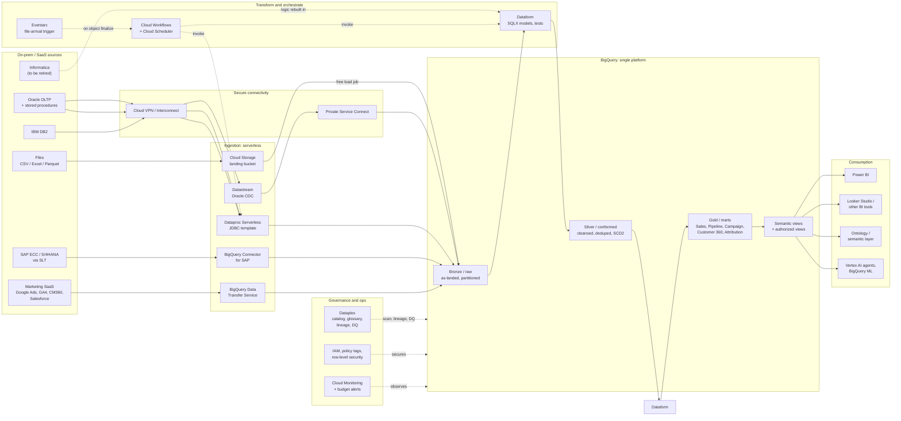
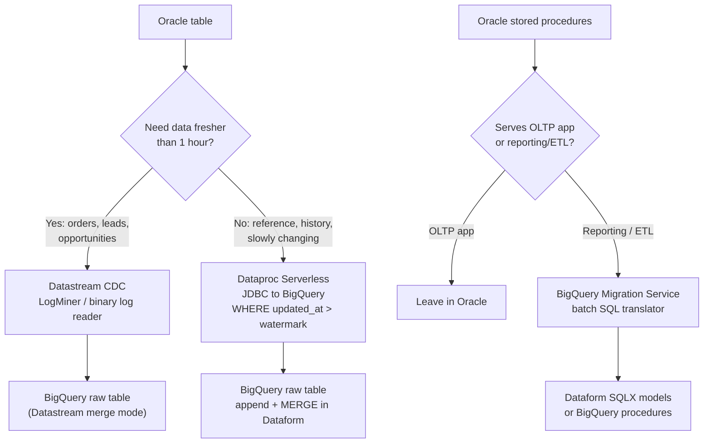
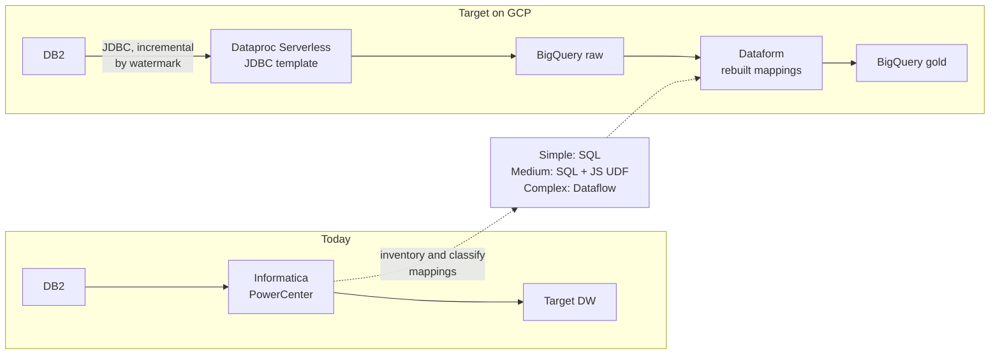
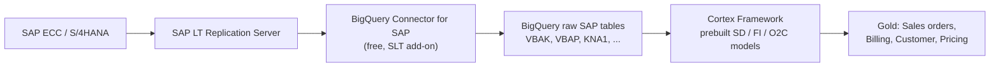
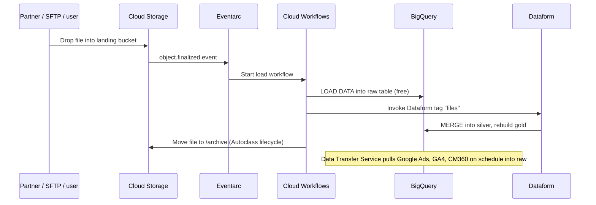
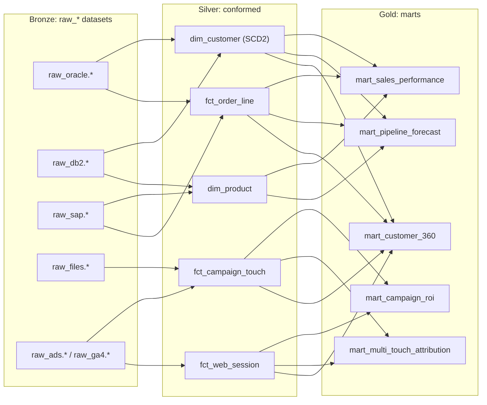
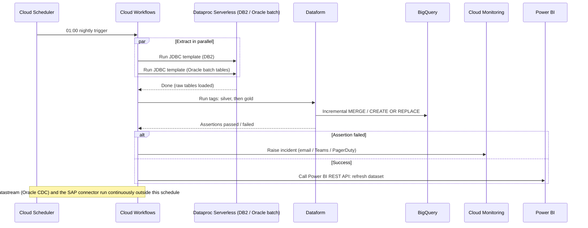
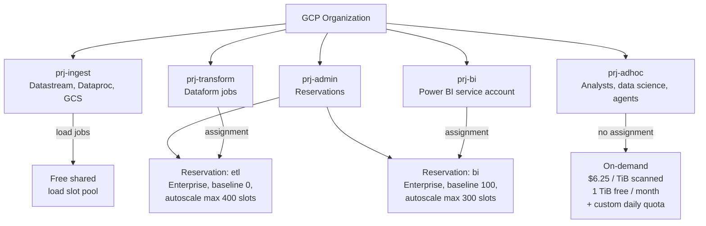
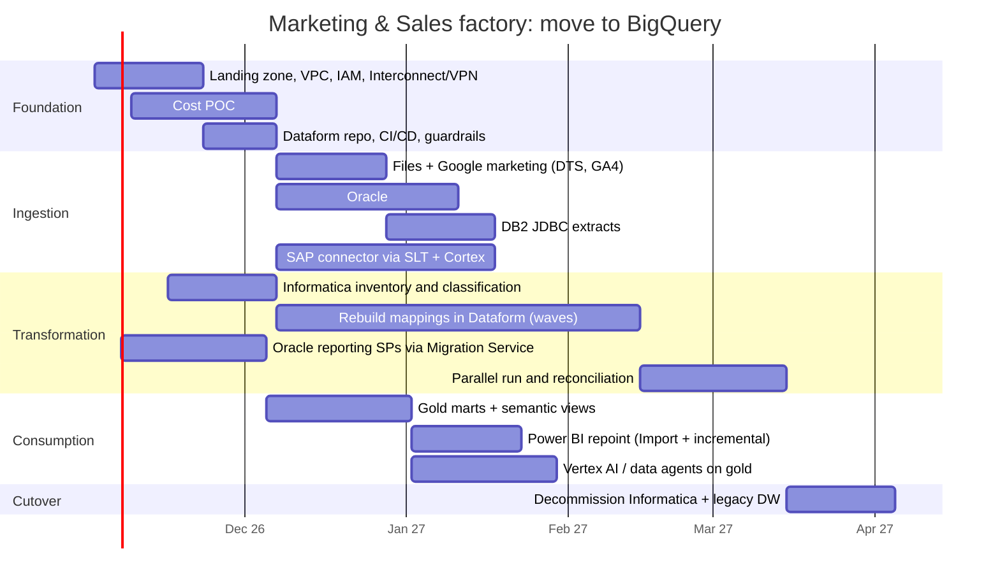

# Marketing & Sales Data Factory on GCP (BigQuery)

Target architecture, migration path and cost case for moving the marketing & sales data factory's sources to **BigQuery**, compared against a **Snowflake** build with the same data volumes and transformation complexity.

> Prices are US list prices (pay-as-you-go) checked October 2026. Verify them for your region in the [BigQuery pricing](https://cloud.google.com/bigquery/pricing), [Datastream pricing](https://cloud.google.com/datastream/pricing) and [Snowflake pricing](https://www.snowflake.com/pricing/) pages before using them in a contract or budget.

---

## 1. Source-to-GCP mapping

| Source | GCP ingestion service | Pattern | Why this choice (cheap and low maintenance) |
|---|---|---|---|
| **Files** (CSV, Excel, JSON, Parquet, partner drops) | Cloud Storage landing bucket, then BigQuery **load jobs** or BigLake external tables | Batch, event-triggered | Batch load jobs into BigQuery are **free**. Nothing to run except a bucket and a trigger. |
| **Oracle OLTP** (incl. stored procedures) | **Datastream** to BigQuery for hot tables; scheduled **JDBC batch extract** for the rest | CDC + incremental batch | Datastream is serverless with no agent. It is billed per GB of change, so use it only where minutes of latency matter (see §6). |
| **Oracle stored procedures** | **BigQuery Migration Service** (batch SQL translator) to Dataform SQLX or BigQuery procedures | Code conversion | Leave OLTP-serving procedures in Oracle. Port only the reporting/ETL ones. |
| **IBM DB2** | **Dataproc Serverless JDBC-to-BigQuery template**, scheduled | Incremental batch (watermark column) | Datastream does not support DB2. The template is pay-per-run with no cluster to look after. |
| **Informatica** mappings/workflows | Re-implement in **Dataform** (SQL ELT) and retire the licence. Complex mappings go to Dataflow templates | Re-platform | Most Informatica mappings are joins, lookups and filters that become plain SQL in Dataform. The licence is usually the biggest cost removed. |
| **SAP** (ECC / S/4HANA) | **BigQuery Connector for SAP** (on SAP LT Replication Server), plus **Cortex Framework** data models | Near-real-time replication | The connector and Cortex are free. Cortex ships prebuilt SAP SD/FI, Salesforce and marketing (Google Ads, CM360, Meta, TikTok) models, which covers most of a marketing & sales factory. |
| **Marketing SaaS** (Google Ads, GA4, CM360, SA360, YouTube, Salesforce) | **BigQuery Data Transfer Service** and GA4 native export | Scheduled managed transfer | Google-source connectors are free. Snowflake would normally need a paid ELT tool (Fivetran or similar). |
| **Ontology / intelligence layer** | **Dataplex Universal Catalog** (business glossary, lineage, data quality) plus a **semantic layer** (Looker LookML or BigQuery views) | Metadata | If "Ontology" means Palantir Foundry, Foundry reads BigQuery natively as a source. |
| **BI tools / Power BI** | Power BI native BigQuery connector (Import mode by default), Looker Studio (free) | Consumption | Import mode with incremental refresh keeps BigQuery spend predictable (see §7.3). |
| **Agentic / AI** | **Vertex AI** (Gemini), **BigQuery ML**, BigQuery data agents / Conversational Analytics, MCP Toolbox for Databases | Consumption | Agents query governed gold tables. Data does not leave the platform. |

---

## 2. End-to-end target architecture

Design principles behind it:

1. **No servers and no clusters.** Every component is serverless or fully managed. There is no Composer/Airflow environment, no Spark cluster and no VM to patch.
2. **One engine.** Raw, conformed and mart layers all live in BigQuery, and transformation is SQL in Dataform. The support team needs one skill set: SQL plus Git.
3. **Load free, transform cheap.** Land data with free batch loads, then pay only for transformation and query compute.

---

## 3. Ingestion detail per source

### 3.1 Oracle: CDC for hot tables, batch for the rest

### 3.2 IBM DB2 + Informatica

**Informatica migration approach**
1. Export the repository (mapping XML) and classify every mapping by complexity.
2. Rebuild *simple* mappings (most of them: source, filter, lookup, aggregate, target) as Dataform SQLX. Gemini in BigQuery or Code Assist can draft the SQL from the mapping XML. An engineer reviews each draft.
3. Run old and new in parallel and reconcile row counts and checksums with Dataform assertions.
4. Retire PowerCenter after the last subject area cuts over.
5. *Risk-averse option:* run Informatica IDMC with BigQuery pushdown for 6 to 12 months, then retire it. This de-risks cutover but keeps a licence.

### 3.3 SAP

If SLT is not licensed, the alternatives are SAP Datasphere replication flows to BigQuery, or Cloud Data Fusion SAP plugins. Data Fusion is an always-on instance, so price it in.

### 3.4 Files and marketing SaaS

---

## 4. Transformation layers (medallion in Dataform)

Conventions that keep cost and support effort low:
- Partition every fact table by date and **cluster** it by the common filter keys (customer, region, campaign). This is the single biggest lever on BigQuery query cost.
- Make silver and gold **incremental** Dataform tables (process only new partitions). Avoid full rebuilds.
- Put a Dataform **assertion** (unique, not null, row-count reconciliation) on every model. Failures alert support through Cloud Monitoring.
- Use **materialized views** for the hot Power BI aggregates. They refresh incrementally and automatically.

---

## 5. Orchestration (no Airflow to run)

Cloud Workflows + Scheduler costs a few dollars a month. A Cloud Composer (Airflow) environment typically costs several hundred dollars a month before any work runs, and it needs upgrades. Move to Composer only if the DAG count grows past what Workflows handles comfortably (roughly 50+ interdependent pipelines).

---

## 6. Cost architecture: how spend is controlled

Choosing the pricing model per project:

| Workload | Model | Reason |
|---|---|---|
| Scheduled ELT (Dataform) | Enterprise edition, autoscale from 0 | Predictable heavy work. You pay only while slots are scaled up, billed per second with a 1-minute minimum. |
| Power BI / BI serving | Enterprise edition, small baseline + autoscale | Steady business-hours load. Caps the cost of DirectQuery bursts. |
| Ad-hoc, data science, agents | **On-demand** with per-user daily quotas | Spiky and often idle. Pays per byte scanned, with no idle warehouse cost. |
| Batch loads from GCS | Free | Shared load slot pool. |

---

## 7. Why BigQuery is cheaper than Snowflake for this workload, and where it isn't

### 7.1 Rate card at list price

| Item | Snowflake (Enterprise, AWS/GCP US) | BigQuery (Enterprise edition, US) |
|---|---|---|
| Compute unit | Credit = **$3.00** on demand. Warehouse sizes double: XS 1, S 2, M 4, L 8, XL 16 credits/hr | Slot-hour = **$0.06** pay-as-you-go. Autoscales in **50-slot** steps. 1-yr / 3-yr commitments are roughly 20% / 40% cheaper |
| Billing granularity | Per second, 60-second minimum on each resume. You also pay the auto-suspend idle window | Per second, 60-second minimum on each scale-up |
| Spiky / ad-hoc queries | A warehouse must run | **On-demand $6.25/TiB scanned, first 1 TiB/month free**. Zero cost when idle |
| Storage (compressed) | ~$23/TB/month (capacity) to ~$40/TB (on demand) + Time Travel / Fail-safe bytes | Physical: ~$41/TiB active, **~$20/TiB long-term (auto after 90 days untouched)** |
| Batch loading | Uses warehouse credits (COPY) or Snowpipe charges | **Free** load jobs |
| Google marketing connectors | Third-party tool (MAR-based pricing) | **Free** (Data Transfer Service, GA4 export) |
| SAP connector + models | Third-party tool or SAP BDC licensing | **Free** (BigQuery Connector for SAP + Cortex). SLT licence still needed |
| Transformation framework | dbt (Core self-run, dbt Cloud seats, or dbt Projects on Snowflake) | **Dataform: free**, built into the BigQuery console |

**Break-even rule of thumb.** One Snowflake credit-hour ($3) buys 50 BigQuery Enterprise slot-hours ($0.06 × 50):

| Snowflake warehouse | $/hour (Enterprise) | BigQuery slots for the same $/hour |
|---|---|---|
| XS | $3 | 50 |
| S | $6 | 100 |
| M | $12 | 200 |
| L | $24 | 400 |
| XL | $48 | 800 |

BigQuery compute is cheaper whenever your workload runs on fewer slots than the column on the right. Snowflake warehouses are sized in doubling steps for the *peak* query and run at that size for the whole window. BigQuery's autoscaler follows actual demand in 50-slot steps. The proof-of-concept (§9) measures that gap. **Do not assume it.**

### 7.2 Worked monthly estimate

**Illustrative workload profile** (replace it with your real numbers):
- 25 TB compressed in the warehouse, about half untouched for more than 90 days.
- Nightly ELT of about 3 h. Intraday merges every 30 min, 07:00 to 19:00.
- About 150 GB/month of Oracle change data needing near-real-time. Everything else runs as daily batch.
- Power BI for about 150 users, 11 business hours × 22 days.
- Analysts and data science run ad hoc about 4 h/day.

| Cost line | Snowflake Enterprise | BigQuery Enterprise | Notes |
|---|---|---|---|
| Nightly ELT | L × 3 h × 30 d = 720 cr → **$2,160** | avg 280 slots × 90 h → **$1,512** | Assumes BigQuery averages 70% of break-even slots |
| Intraday merges | S, 2 h/day billed → 120 cr → **$360** | 100 slots × 60 h → **$360** | Parity |
| Batch / file loads | XS 2 h/day → 60 cr → **$180** | **$0** | Free load jobs |
| BI serving | M multi-cluster, avg 1.5 × 242 h → 1,452 cr → **$4,356** | avg 210 slots × 242 h → **$3,049** | Same Import-mode pattern on both |
| Ad-hoc / data science | S × 88 h → 176 cr → **$528** | ~15 TiB scanned − 1 TiB free → **$88** | On-demand, with quotas |
| Oracle near-real-time CDC | CDC tool licence (not quantified) | Datastream 150 GiB × $2 → **$300** | |
| DB2 / Oracle batch extract | ETL tool licence (not quantified) | Dataproc Serverless → **~$150** | |
| Storage | 25 TB × $23 + ~15% Time Travel / Fail-safe → **~$660** | 12 TiB active + 13 TiB long-term + ~10% → **~$830** | **Snowflake is cheaper here** |
| **Platform total / month** | **≈ $8,244** + tool licences | **≈ $6,290** | **About 24% lower** before licences |
| **Platform total / year** | **≈ $99k** + tool licences | **≈ $75k** | |

**Sensitivity.** The answer depends on how many slots your SQL actually needs:

| BigQuery slots used vs break-even | BigQuery / month | vs Snowflake |
|---|---|---|
| 60% | ~$5,640 | **−32%** |
| 70% (base case) | ~$6,290 | **−24%** |
| 100% (no right-sizing gain) | ~$8,240 | parity: savings come only from free loads and on-demand ad hoc |
| 120% (BigQuery less efficient for this SQL) | ~$9,550 | **+16%** |

### 7.3 Where the savings actually come from (in order of size)

1. **Licences removed** (usually the biggest number, and outside both tables above):
   - Informatica PowerCenter retired. This saving applies to *both* targets, so it does not favour either.
   - **No paid ELT connector** for Google Ads, GA4, CM360, SA360 or YouTube. These are free on GCP and typically paid per volume on Snowflake.
   - **No paid SAP replication tool**, and Cortex provides prebuilt sales and marketing models (weeks of modelling work saved).
   - **Dataform** is free, compared with dbt Cloud seats.
2. **Free ingestion.** Every batch load and file load costs $0 in compute.
3. **On-demand for spiky users.** Analysts, data scientists and AI agents pay per TiB scanned. There is no warehouse sitting idle or auto-suspending.
4. **Right-sized autoscaling** (50-slot steps instead of doubling warehouse sizes), *if* the POC confirms it.
5. **Long-term storage halves automatically** for partitions untouched for 90 days, with no tiering job to run.
6. **No orchestration servers.** Workflows + Scheduler replace an Airflow environment.

### 7.4 Where Snowflake is equal or better (be honest with stakeholders)

- **Storage at capacity pricing** (~$23/TB) is cheaper than BigQuery physical active storage (~$41/TiB).
- **Heavy, steady, high-concurrency BI** that keeps warehouses fully busy narrows the gap to near parity.
- **Power BI egress.** If Power BI runs in Azure, query results leaving GCP pay network egress. Use Import mode with incremental refresh and aggregated marts, not wide DirectQuery.
- **Unguarded on-demand use** (`SELECT *` on unpartitioned multi-TB tables) can be more expensive than a Snowflake warehouse. The guardrails in §8 are required, not optional.
- **Existing Snowflake skills or contracts.** A large prepaid Snowflake capacity commitment can outweigh the list-price comparison.

---

## 8. Low-maintenance operating model ("cheap and best")

**Cost guardrails, set on day 1**
- `maximum_bytes_billed` set on Dataform and BI service accounts. Custom **per-user daily query quotas** on the on-demand project.
- Partition filter required (`require_partition_filter = true`) on large fact tables.
- Billing budgets with alerts at 50%, 80% and 100%. A weekly cost report from `INFORMATION_SCHEMA.JOBS` (top 20 queries by slot-ms and bytes).
- Physical storage billing on datasets with good compression. Autoclass on the GCS landing bucket.

**Support model.** About 2 to 3 engineers can run it, because there are no clusters, VMs or Airflow to patch.

| Task | Tool | Effort |
|---|---|---|
| Pipeline failures | Dataform assertions + Workflows → Cloud Monitoring alert | Alert-driven |
| Data quality | Dataplex auto data quality scans | Configure once |
| Lineage / impact analysis | Dataplex lineage (automatic for BigQuery jobs) | None |
| Access | IAM groups, policy tags (PII), row-level security | Per new role |
| Platform upgrades | None: all components are serverless | None |
| Cost review | Weekly `INFORMATION_SCHEMA` report | 30 min/week |

---

## 9. Migration roadmap

**Go / no-go gate (end of the cost POC).** Export 30 days of query history from the current warehouse (`SNOWFLAKE.ACCOUNT_USAGE.QUERY_HISTORY` and `WAREHOUSE_METERING_HISTORY`, or the legacy DW logs). Replay the top 50 workloads on BigQuery and compare actual slot-hours from `INFORMATION_SCHEMA.JOBS`. Proceed with BigQuery if the measured slot usage is **at or below about 85% of break-even** (§7.1). Above that, the savings rest only on licences and ingestion, and you should re-check them against your Snowflake contract.

---

## 10. Summary

- **Architecture.** Every source lands in BigQuery through serverless services: Datastream for Oracle, Dataproc Serverless for DB2, the free SAP connector, Data Transfer Service for marketing data, and GCS for files. Dataform transforms the data, Workflows orchestrates it, and Dataplex governs it. Power BI, the ontology layer and AI agents read from one set of gold marts.
- **Cost.** At list price the estimate is **about 20 to 30% lower platform cost** than Snowflake for the same workload. Most of that comes from free ingestion, free Google/SAP connectors, on-demand pricing for spiky users and no idle compute. Retiring Informatica adds savings on either target. Storage is the one line where Snowflake is cheaper.
- **Support.** There are no servers, clusters or Airflow environments, so a small team can run it, with SQL + Git as the only core skill.
- **Next step.** Run the 4-week cost POC before committing. It turns the 70% slot assumption into a measured number.
