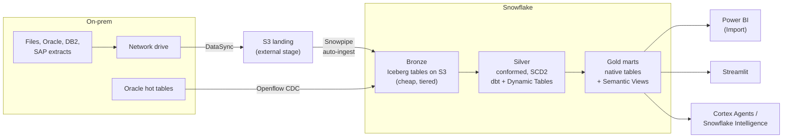
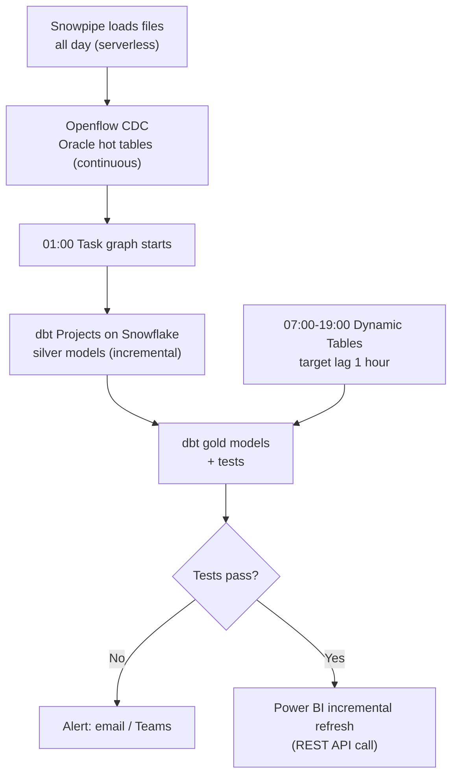
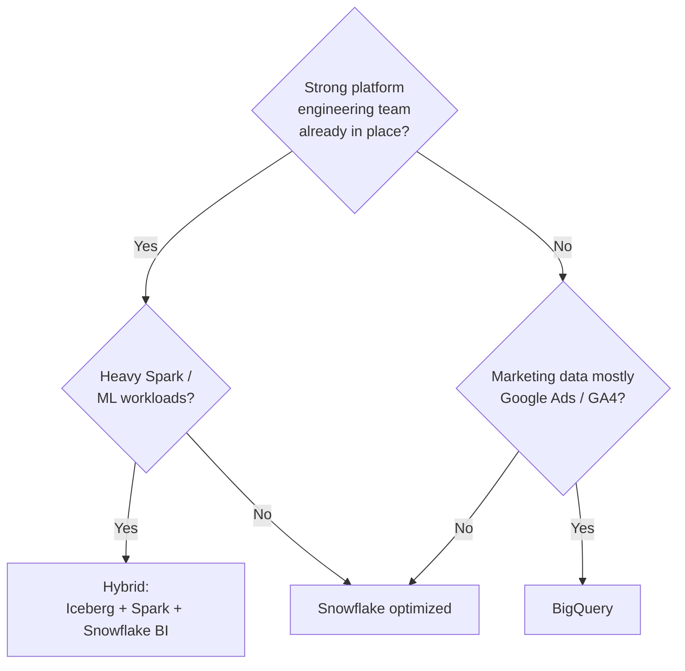
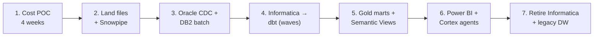

# Marketing & Sales Data Factory: Snowflake-native design at 100s of TB

Target design for moving the marketing & sales data factory onto **Snowflake-native services**, sized for **100 to 600 TB** (compressed), with a cost model, the cheaper Snowflake build, and cheaper alternatives to the cost-heavy tools.

* GCP / BigQuery version of the same factory: [mktg-sales-factory-gcp.md](mktg-sales-factory-gcp.md)

> **Prices.** US list prices, Snowflake Enterprise edition on AWS: **$3.00 per credit**, **$23/TB/month** capacity storage. Snowpipe is billed at **0.0037 credits per GB** ingested. AWS S3 tiers: Standard ~$23/TB, Infrequent ~$12.5/TB, Archive Instant ~$4/TB. All estimates below are **illustrative** and are meant to be replaced with numbers from your own query history. Check the [Snowflake pricing](https://www.snowflake.com/pricing/) and [Service Consumption Table](https://www.snowflake.com/legal-files/CreditConsumptionTable.pdf) before budgeting.

---

## 1. Objectives

| # | Objective | How this design meets it |
|---|---|---|
| 1 | Move to technologies **native to Snowflake** | Openflow, Snowpipe, dbt Projects on Snowflake, Dynamic Tables, Tasks, Horizon, Cortex. No external ETL server, scheduler or catalog. |
| 2 | Be **cost effective** at the same data volume and transform complexity | The optimized Snowflake build (§6) costs **about half** of a lift-and-shift Snowflake build. §7 compares it with cheaper platforms. |
| 3 | **Cheap and best**, with low maintenance and a small support team | Everything is serverless or managed. One skill set: SQL + Git. About 2 to 3 engineers can run it (§9). |
| 4 | **Alternatives** to cost-heavy technologies | §8 lists each expensive tool and its native or open-source replacement. |

---

## 2. Sources (today: everything lands on an on-prem network drive)

| Source | Lands today as | Snowflake-native path | Load pattern | Notes |
|---|---|---|---|---|
| **Files** (CSV, Excel, JSON, Parquet) | Files on network drive | AWS DataSync agent → S3 external stage → **Snowpipe auto-ingest** | Event-driven micro-batch | Cheapest path. Snowpipe has no warehouse to run. |
| **Oracle OLTP** (tables) | Nightly extract files | **Openflow Oracle CDC connector** for hot tables. Keep file extracts for the rest. | CDC + daily batch | Use CDC only where sub-hour freshness is needed. CDC compute runs 24×7. |
| **Oracle stored procedures** | Run in Oracle | **SnowConvert AI** (free) → Snowflake Scripting procedures or dbt models | Code conversion | Leave procedures that serve the OLTP app in Oracle. Convert only reporting/ETL logic. |
| **IBM DB2** | Extracts via Informatica | **Openflow** database (JDBC) connector, incremental by watermark column | Daily batch | Or keep DB2 file exports to the drive and use Snowpipe. |
| **Informatica** mappings | PowerCenter workflows | **dbt Projects on Snowflake** + **Dynamic Tables**. SnowConvert AI can draft conversions. | Re-platform | Retiring the licence is usually the largest single saving. |
| **SAP** (ECC / S/4HANA) | Extract files | **SAP BDC Connect for Snowflake** (zero-copy) if you are on SAP Business Data Cloud. Otherwise keep SAP extracts → Snowpipe. | Zero-copy or batch | Avoid a paid replication tool unless near-real-time SAP is required. |
| **Ontology / intelligence** | n/a | **Semantic Views** + **Horizon Catalog** (glossary, lineage, tags) | Metadata | The semantic view is the single business definition used by BI and AI. |

### Added features

| Feature | Snowflake-native option | Cost note |
|---|---|---|
| **BI tools** | Streamlit in Snowflake for internal apps. Any JDBC/ODBC BI tool. | Streamlit runs on a warehouse; size it XS and auto-suspend. |
| **Power BI** | Native Snowflake connector, **Import mode + incremental refresh** on gold marts | Import mode keeps warehouse time to the refresh window. DirectQuery keeps a warehouse up all day. |
| **Agentic** | **Cortex AI functions**, **Cortex Analyst** (on semantic views), **Cortex Agents** / Snowflake Intelligence, Snowflake MCP server | Billed per token / per message. Set a monthly budget and a resource monitor. |

---

## 3. End-to-end flow

| Layer | Storage format | Why |
|---|---|---|
| Landing | S3 objects, deleted or archived after load | Snowpipe reads it once. S3 lifecycle moves files to Glacier after 30 days. |
| **Bronze** (largest, 50 to 70% of bytes) | **Snowflake-managed Iceberg tables in your S3** with Intelligent-Tiering | No Snowflake storage charge and no Fail-safe. Untouched history drops to ~$4 to $12/TB automatically. |
| **Silver** | Native tables, **transient** for rebuildable work tables | Transient tables skip the 7-day Fail-safe copy, which is large on high-churn tables. |
| **Gold** | Native tables, clustered on date + main filter key | Fastest for BI. Small (5 to 10% of bytes). |

---

## 4. Nightly and intraday schedule

| Job | Native service | Warehouse | Billed time |
|---|---|---|---|
| File loads | Snowpipe | none (serverless) | per GB |
| Oracle CDC | Openflow | Openflow runtime | 24×7 runtime |
| Nightly silver + gold | dbt Projects on Snowflake, triggered by a Task graph | `WH_ELT` (L) | ~4 h/night at 1 TB/day of change |
| Intraday freshness | Dynamic Tables, target lag 1 h | `WH_DT` (S) | ~6 billed h/day |
| Power BI refresh | Import, incremental | `WH_BI` (M) | ~2 h/day |
| Ad hoc / data science | Snowsight, notebooks | `WH_ADHOC` (M), 60 s auto-suspend | ~4 h/business day |

---

## 5. Sizing assumptions

| Scale | Compressed data | Change landed per day | Power BI users | Ad hoc users |
|---|---|---|---|---|
| Small | 100 TB | 0.4 TB | 300 | 25 |
| **Base** | **300 TB** | **1 TB** | **300** | **25** |
| Large | 600 TB | 2 TB | 300 | 25 |

Note: at this scale, **compute follows the daily change volume, not the total size**, as long as models are incremental. Storage follows total size. That is why storage tiering matters more than warehouse tuning once you pass ~100 TB.

---

## 6. Cost: lift-and-shift vs optimized Snowflake (base 300 TB, per month)

| Cost line | Lift-and-shift Snowflake | Credits | $ | Optimized Snowflake | Credits | $ |
|---|---|---|---|---|---|---|
| Nightly ELT | XL × 4 h × 30 d | 1,920 | **5,760** | L × 4 h × 30 d (incremental dbt) | 960 | **2,880** |
| Intraday merges | M × 6 h × 30 d | 720 | **2,160** | Dynamic Tables on S × 6 h × 30 d | 360 | **1,080** |
| Power BI refresh | L × 2 h × 30 d | 480 | **1,440** | M × 2 h × 30 d (incremental refresh) | 240 | **720** |
| BI serving | M multi-cluster, avg 1.5 × 242 h (DirectQuery) | 1,452 | **4,356** | S multi-cluster, avg 1.2 × 242 h (Import mode) | 581 | **1,742** |
| Ad hoc / data science | L × 88 h | 704 | **2,112** | M × 88 h, 60 s suspend, resource monitor | 352 | **1,056** |
| File ingestion | Snowpipe 30 TB × 0.0037 cr/GB | 111 | **333** | same | 111 | **333** |
| Oracle CDC | Openflow runtime (estimate) | | **900** | same | | **900** |
| Storage | 300 TB native × $23 + 15% Time Travel / Fail-safe | | **7,935** | 90 TB native × $23 + 5%, 210 TB Iceberg on S3 at ~$8/TB avg | | **3,854** |
| Cortex AI / agents | open budget | | **1,000** | budget-capped | | **500** |
| Network + DataSync | | | **500** | | | **500** |
| **Total / month** | | 5,387 | **≈ $26,500** | | 2,604 | **≈ $13,570** |
| **Total / year** | | | **≈ $318k** | | | **≈ $163k** |

**Result: about 49% lower** with the same data, same transforms, same users. A capacity contract (pre-purchased credits) typically takes another 10 to 25% off both columns.

### Same comparison at other scales

| Scale | Lift-and-shift / month | Optimized / month | Optimized / year | Saving |
|---|---|---|---|---|
| 100 TB | ≈ $16,250 | ≈ $8,420 | ≈ $101k | 48% |
| **300 TB** | **≈ $26,500** | **≈ $13,570** | **≈ $163k** | **49%** |
| 600 TB | ≈ $42,680 | ≈ $21,710 | ≈ $261k | 49% |

### Where the savings come from

| Lever | Saving at 300 TB / month | What to do |
|---|---|---|
| Bronze history on Iceberg + S3 Intelligent-Tiering | ~$4,100 | Biggest lever at 100s of TB. Keep only silver/gold as native storage. |
| Power BI Import instead of DirectQuery | ~$3,300 | Smaller BI warehouse, multi-cluster rarely scales out. |
| Incremental dbt models (one warehouse size down) | ~$2,900 | Process only new partitions. Full rebuilds only on weekends if ever. |
| Dynamic Tables instead of hand-written merge jobs | ~$1,100 | Snowflake refreshes only changed rows. |
| Ad hoc warehouse M + 60 s auto-suspend + resource monitor | ~$1,050 | Hard monthly credit quota per warehouse. |
| Transient tables for work tables | included in storage line | No Fail-safe bytes on rebuildable data. |

---

## 7. Is Snowflake the cheapest? Platform alternatives (base 300 TB)

Loaded engineer cost assumed at **$160k/year** (~$13.3k/month). At 100s of TB the people cost is as large as the platform bill, so it is included.

| Option | Platform / month | Support FTE | Total cost of ownership / month | Fit |
|---|---|---|---|---|
| Snowflake, lift-and-shift | ~$26.5k | 2.5 | **~$59.8k** | Baseline. Avoid. |
| **Snowflake, optimized (this design)** | **~$13.6k** | **2.5** | **~$46.9k** | **Recommended.** Lowest TCO and lowest support effort. |
| BigQuery ([GCP design](mktg-sales-factory-gcp.md)) | ~$13k to $16k | 2.5 | ~$46k to $49k | Similar. Wins if marketing data is mostly Google Ads / GA4 (free connectors). |
| Hybrid: Iceberg on S3 + EMR Serverless Spark for heavy ELT, Snowflake for gold/BI only | ~$10k to $12k | 3.5 | ~$57k to $59k | Cheaper bill, but more moving parts and more people. |
| Full open source: Iceberg + Trino/Spark on Kubernetes, DuckDB for small marts | ~$6k to $9k | 5 | ~$73k to $76k | Cheapest bill, most expensive to run. Only with a strong platform team. |

**Note:** the open options only win if you already have the engineers. For a "cheap with low support" goal, the optimized Snowflake build is the best balance.

---

## 8. Alternatives to cost-heavy technologies

| Cost-heavy today | Why it is expensive | Snowflake-native replacement | Open-source / low-cost fallback |
|---|---|---|---|
| **Informatica PowerCenter / IDMC** | Annual licence + servers + specialist skills | dbt Projects on Snowflake, Dynamic Tables, Openflow | dbt Core in a CI runner |
| **Fivetran / paid ELT connectors** | Priced per monthly active rows; grows with volume | Openflow connectors, Snowpipe, Marketplace data shares | dlt or Airbyte OSS |
| **Qlik Replicate / HVR / GoldenGate** for Oracle CDC | Per-core or per-source licence | Openflow Oracle CDC connector | Daily watermark extracts (no CDC) |
| **Paid SAP replication tool** | Licence per SAP system | SAP BDC Connect (zero-copy) | Existing SAP extract files + Snowpipe |
| **Airflow / Control-M** servers | Servers, upgrades, licence | Tasks and task graphs (serverless) | GitHub Actions cron for simple chains |
| **Collibra / Alation** catalog | Per-user licence | Horizon Catalog: tags, lineage, masking, data metric functions | OpenMetadata |
| **Palantir / separate ontology tool** | Platform licence | Semantic Views + Cortex Analyst | dbt semantic layer (MetricFlow) |
| **Power BI Premium / Fabric capacity** | Fixed monthly capacity | Power BI Pro + Import mode on small gold marts. Streamlit for internal apps. | Apache Superset |
| **Snowflake storage for cold history** | $23/TB plus Fail-safe | Iceberg tables on S3 with Intelligent-Tiering | Same |
| **Business Critical edition** | $4+ per credit | Enterprise ($3) unless you need PHI/PCI or private connectivity features | Standard ($2) if no masking or multi-cluster needed |

---

## 9. Low-maintenance operating model

**Cost guardrails (set on day 1)**

| Guardrail | Setting |
|---|---|
| Resource monitors | One per warehouse; notify at 75%, suspend at 100% of monthly credits |
| Auto-suspend | 60 s on every warehouse |
| Warehouse sizes | Fixed in code (Terraform). No one resizes by hand. |
| Query timeout | `STATEMENT_TIMEOUT_IN_SECONDS = 3600` on ad hoc warehouse |
| Cortex budget | Monthly limit with alerts |
| Weekly review | Top 20 queries by credits from `ACCOUNT_USAGE.QUERY_ATTRIBUTION_HISTORY` (30 min/week) |

**Support team: about 2 to 3 engineers**

| Task | Tool | Effort |
|---|---|---|
| Pipeline failures | dbt tests + Task graph alerts | Alert-driven |
| Data quality | Data metric functions (Horizon) | Configure once |
| Lineage | Horizon lineage (automatic) | None |
| Access control | Roles, masking policies, row access policies | Per new role |
| Platform upgrades | None; Snowflake is fully managed | None |
| Cost review | Weekly query report | 30 min/week |

---

## 10. Migration path

| Phase | Duration | Exit check |
|---|---|---|
| 1. Cost POC | 4 weeks | Replay top 50 queries; measured credits within 15% of §6 |
| 2. Files + Snowpipe | 3 weeks | Daily file volume landing in bronze with row-count reconciliation |
| 3. Oracle CDC + DB2 | 5 weeks | Hot tables < 15 min lag; batch tables reconciled |
| 4. Informatica → dbt | 10 to 14 weeks | Old and new outputs match on row counts and checksums |
| 5. Gold + Semantic Views | 4 weeks | Business sign-off on KPI definitions |
| 6. Power BI + agents | 4 weeks | Reports repointed; Cortex Analyst answers verified questions |
| 7. Decommission | 3 weeks | Informatica licence and legacy DW switched off |

---

## 11. Summary

* **Architecture.** Network-drive files go to S3 and load with Snowpipe; Oracle hot tables use Openflow CDC; Informatica logic moves to dbt Projects on Snowflake and Dynamic Tables; Horizon governs it; Power BI, Streamlit and Cortex agents read one set of gold marts and semantic views.
* **Cost at 300 TB.** Lift-and-shift Snowflake ≈ **$318k/year**. Optimized Snowflake ≈ **$163k/year** (about 49% lower), before capacity discounts and before the Informatica and connector licences you retire.
* **Biggest lever at 100s of TB.** Keep cold bronze history in Iceberg on tiered S3, not in Snowflake native storage.
* **Cheaper platforms exist,** but they need more engineers. Counting people, the optimized Snowflake build has the lowest total cost.
* **Next step.** Run the 4-week cost POC on your real query history to replace these estimates with measured credits.
