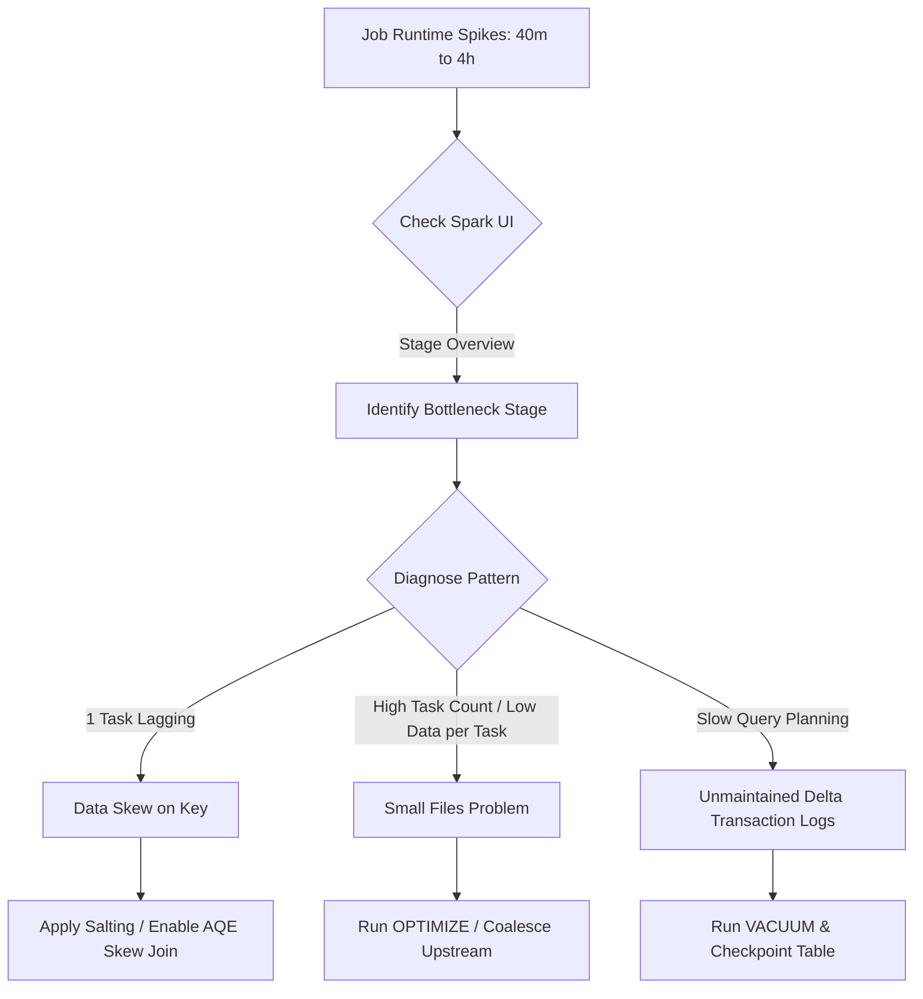
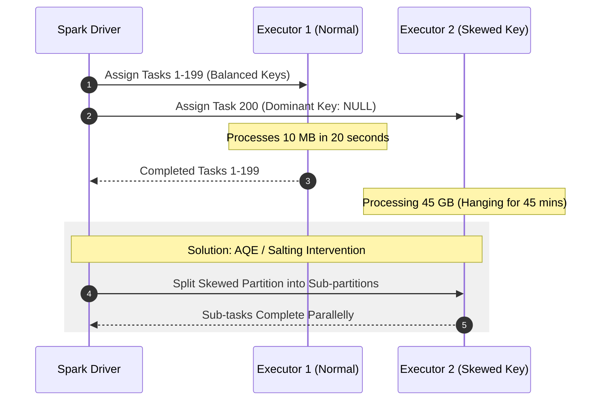
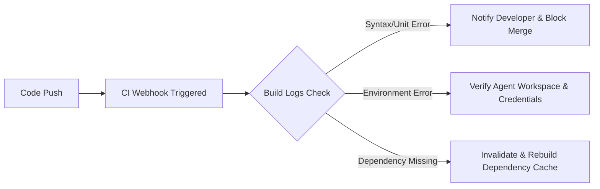
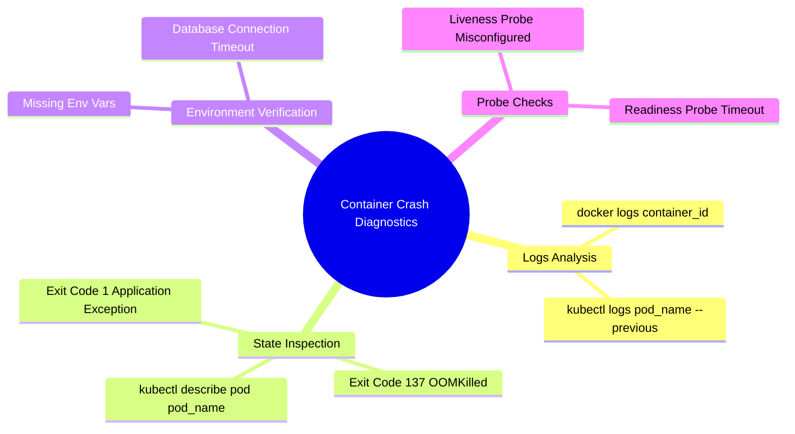
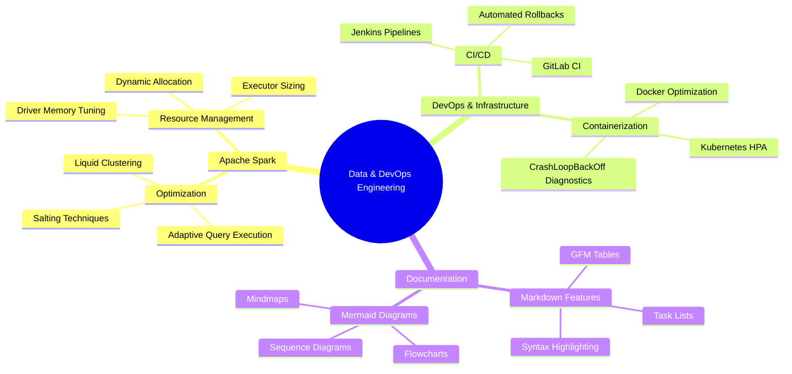

# Comprehensive Scenario-Based Q&A: Apache Spark, DevOps & Markdown Engineering

---

## Section 1: Apache Spark Performance & Architecture Scenarios

### Scenario 1: Sudden Pipeline Degradation (40 Minutes to 4 Hours)
**Context:** A nightly data processing pipeline handling a consistent ~50 GB dataset ran reliably in 40 minutes for months. Suddenly, without any new code deployment or data volume increase, the runtime spiked to 4 hours [18].

**Root Cause Analysis:**
1. **Data Skew:** While total volume remains 50 GB, the internal distribution across keys may have shifted dramatically, creating a single massive partition handled by one straggler executor [18].
2. **Small File Proliferation:** Upstream data sources may have written the 50 GB across thousands of tiny KB-sized files, causing driver overhead during file listing and partition metadata management [18].
3. **Delta Transaction Log Accumulation:** Without periodic `VACUUM` and `OPTIMIZE` operations on Delta Lake tables, reading history and log metadata during query planning increases execution latency [18].
4. **Partition Pruning Failure:** Upstream changes to table partition columns or querying non-partitioned date columns force full table scans across the entire 50 GB dataset [18].

---

### Scenario 2: Straggler Tasks in Stage (199/200 Tasks Complete in 20s, 1 Task Runs for 45m)
**Context:** In a 200-task stage, 199 tasks finish in under 20 seconds, while a single remaining task hangs for 45 minutes before failing or finishing [18].

**Diagnosis & Remediation:**
* **Diagnosis:** Classic data skew where a dominant key (e.g., `NULL`, default values, or high-cardinality customer IDs) routes the majority of dataset records to a single reducer partition [18].
* **Remediation Techniques:**
  1. **Adaptive Query Execution (AQE):** Ensure `spark.sql.adaptive.enabled` and `spark.sql.adaptive.skewJoin.enabled` are set to `true`. AQE automatically splits skewed partitions into smaller sub-partitions [18].
  2. **Salting Technique:** Append a random integer (e.g., `0` to `N-1`) to the join/grouping key on the skewed dataset and explode the lookup table by `N` to distribute keys across multiple executors [18].
  3. **Broadcast Join:** Convert the join to a `broadcast` join if one dataset is small enough, completely bypassing the shuffle phase [18].

---

### Scenario 3: AQE Enabled but Skew Optimization Fails
**Context:** AQE is explicitly enabled (`spark.sql.adaptive.enabled=true`), yet a single task still lags significantly during execution [18].

**Root Causes & Threshold Conditions:**
* **Non-Join Operations:** AQE's automatic skew handling applies primarily to shuffle joins. High-cardinality `GROUP BY` or `DISTINCT` operations without joins do not trigger AQE skew join splitting [18].
* **Threshold Restrictions:** AQE triggers skew join handling only when a partition satisfies two conditions simultaneously:
  1. **Size Threshold:** Partition size exceeds `spark.sql.adaptive.skewJoin.skewedPartitionThresholdInBytes` (default: 256 MB) [18].
  2. **Factor Threshold:** Partition size is greater than `spark.sql.adaptive.skewJoin.skewedPartitionFactor` times the median partition size (default: 5x) [18].
* **Fixes:** Lower the threshold parameters or refactor `GROUP BY` to two-stage two-phase aggregations (`partial` and `final` aggregation) or `reduceByKey` [18].

---

### Scenario 4: Shuffle Partition Misconfiguration (2 TB vs. 500 MB Workloads)
**Context:** Comparing default `spark.sql.shuffle.partitions = 200` across drastically different workload scales [18].

| Workload Volume | Configured Partitions | Avg Size per Partition | Impact & Behavior | Recommended Fix |
| :--- | :---: | :---: | :--- | :--- |
| **2 TB Dataset** | 200 | ~10 GB / partition | **Out of Memory (OOM) Errors**, excessive disk spilling, GC pauses [18]. | Set partitions to ~16,000 (~128 MB target size) [18] |
| **500 MB Dataset** | 200 | ~2.5 MB / partition | **Small File Overhead**, driver task scheduling bottleneck, high I/O latency [18]. | Reduce partitions to 4–8 or enable `spark.sql.adaptive.coalescePartitions.enabled` [18] |

---

### Scenario 5: Cluster Sizing Trade-Offs (40 Small Nodes vs. 10 Large Nodes)
**Context:** A team converts an Apache Spark cluster from 40 small worker nodes (2 cores, 8 GB RAM each) to 10 large worker nodes (8 cores, 32 GB RAM each). Total CPU cores (80) and memory (320 GB) remain constant, but job execution speeds up drastically [18].

**Why the Large Node Architecture Performs Faster:**
1. **Reduced Network Shuffle Overhead:** Shuffling data across 10 physical IP endpoints requires fewer network connections, serialization/deserialization calls, and socket handshakes than communicating across 40 nodes [18].
2. **Local Data Processing:** Co-locating tasks on larger nodes allows shuffle data transfers to occur in local memory or local loopback disk I/O rather than traversing physical network switches [18].
3. **Cheaper Broadcast Joins:** Broadcasted datasets are replicated only 10 times across the cluster instead of 40 times, preserving network bandwidth and memory footprint [18].

---

## Section 2: DevOps & Cloud Engineering Scenarios

### Scenario 6: CI/CD Pipeline Failure Post-Commit
**Context:** A developer pushes a code commit to the repository, and the CI/CD pipeline fails immediately [4].

**Standard Operating Procedure (SOP):**
1. **Inspect Build Logs:** Search for explicit compilation, linting, or dependency resolution errors [4].
2. **Verify Branch & Webhook:** Confirm webhook payload status (200 OK) and ensure build scripts target the correct branch [4].
3. **Check Workspace Permissions & Caching:** Validate build agents have permissions to download artifacts and write to workspace directories [4].
4. **Isolated Test Execution:** Re-run unit tests locally inside a containerized environment mirroring the CI worker node [4].

---

### Scenario 7: Docker Container Restart Loop & Kubernetes Crash Loop
**Context:** A newly deployed container enters a continuous restart loop (`CrashLoopBackOff` in Kubernetes) [4].

**Troubleshooting Matrix:**

* **Exit Code 137 (`OOMKilled`):** Container memory usage exceeded defined resource limits (`resources.limits.memory`). Increase limit allocations in pod manifest [4].
* **Exit Code 1 / Application Error:** Check missing environment secrets, unhandled exceptions during runtime initialization, or invalid binary arguments (`CMD` / `ENTRYPOINT`) [4].
* **Probe Misconfiguration:** Ensure liveness probes allow sufficient delay (`initialDelaySeconds`) for application startup before health checking [4].

---

### Scenario 8: Environmental Drift (Staging Succeeds, Production Fails)
**Context:** An application package builds and passes all integration tests in the staging environment but fails upon deployment to production [4].

**Root Causes & Mitigations:**
* **Unsynchronized Dependencies:** OS library version mismatches or runtime differences between staging and production hosts [4].
* **Mitigation Strategy:**
  1. **Containerization:** Package application dependencies, binaries, and OS baseline into immutable Docker images [4].
  2. **Infrastructure as Code (IaC):** Use Terraform and Ansible to provision identical staging and production environments automatically, eliminating manual configuration drift [4].
  3. **Secret & Config Management:** Utilize centralized secret managers to ensure environment variables are validated prior to runtime execution [4].

---

## Section 3: Markdown & Mermaid Syntax Reference Guide

### Advanced Markdown Tables Syntax
Standard GFM Markdown tables support column alignment, inline formatting, and code styling [2, 9, 19]:

| Component | Status | Priority | Performance Target | Documentation |
| :--- | :---: | :---: | ---: | :--- |
| **Spark Core** | 🟢 Stable | 🔴 High | `< 200 ms` | Spark Documentation |
| **Delta Lake** | 🟡 Updating | 🟠 Medium | `< 500 ms` | Delta Documentation |
| **Kubernetes** | 🟢 Active | 🟣 Low | `99.99% Uptime` | K8s Documentation |

**Rendered Result:**

| Component | Status | Priority | Performance Target | Documentation |
| :--- | :---: | :---: | ---: | :--- |
| **Spark Core** | 🟢 Stable | 🔴 High | `< 200 ms` | Spark Documentation |
| **Delta Lake** | 🟡 Updating | 🟠 Medium | `< 500 ms` | Delta Documentation |
| **Kubernetes** | 🟢 Active | 🟣 Low | `99.99% Uptime` | K8s Documentation |

---

### Comprehensive Technical Stack Mindmap

---

## Conclusion & Checklist for Engineering Interviews

- [x] **Spark Skew:** Identify stragglers using Spark UI; resolve via salting, AQE skew join, or broadcasting [18].
- [x] **Partition Sizing:** Aim for target partition sizes between 100 MB – 200 MB (128 MB default) [18].
- [x] **Kubernetes Debugging:** Leverage `kubectl logs --previous` and inspect exit codes (e.g., 137 for OOM) [4].
- [x] **Markdown Standards:** Utilize GFM alignment, clean pipe tables, and standard Mermaid diagrams for clear technical documentation [1, 2, 6, 14].
